## Stage 1 — Creating the Three-Node Cluster
Created the dso202 cluster from cluster producing one control-plane and two worker nodes as Docker containers, and confirmed kubectl was pointed at the new cluster.


Checking if the same three nodes are working as a Docker containers.

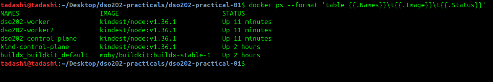

Confirming if kubectl is pointing at the new cluster.

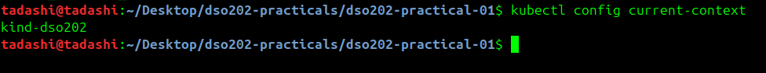

### Check Point


## Stage 2 — Inspecting the Cluster and Its Components

Checking the cluster where its control plane is.

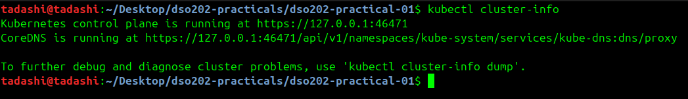

Listing all the nodes in the cluster.

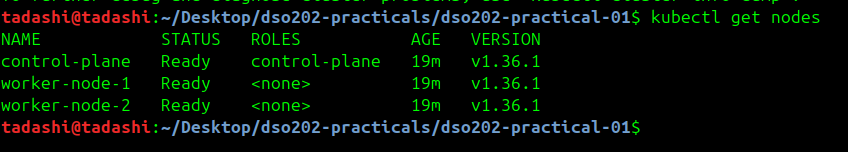

By adding -o wide to get more detail without switching to full YAML output.

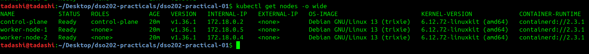

Reading one node in detail and locating the labels applied by kind-cluster.yaml (Listing 1). Three things are important from the output. 

1. Labels : It includes dso202/node-role=worker and dso202/node-index=1, both set by kind-cluster.yaml (Listing 1)

```cmd
Labels:             beta.kubernetes.io/arch=amd64
                    beta.kubernetes.io/os=linux
                    dso202/node-index=1
                    dso202/node-role=worker
                    kubernetes.io/arch=amd64
                    kubernetes.io/hostname=worker-node-1
                    kubernetes.io/os=linux
```
2. Capacity and Allocatable : it is the total CPU and memory the node reports and how much of it Kubernetes will hand out

```cmd
Capacity:
  cpu:                8
  ephemeral-storage:  65739308Ki
  hugepages-1Gi:      0
  hugepages-2Mi:      0
  memory:             3715884Ki
  pods:               110
Allocatable:
  cpu:                8
  ephemeral-storage:  65739308Ki
  hugepages-1Gi:      0
  hugepages-2Mi:      0
  memory:             3715884Ki
  pods:               110
```
3. Non-terminated Pods : it shows every Pod currently placed on the node with its CPU and memory requests

```cmd
Non-terminated Pods:          (2 in total)
  Namespace                   Name                CPU Requests  CPU Limits  Memory Requests  Memory Limits  Age
  ---------                   ----                ------------  ----------  ---------------  -------------  ---
  kube-system                 kindnet-cr6v2       100m (1%)     100m (1%)   50Mi (1%)        50Mi (1%)      23m
  kube-system                 kube-proxy-g692g    0 (0%)        0 (0%)      0 (0%)           0 (0%)         23m
```

Listing the namespaces that exist before any work is done.

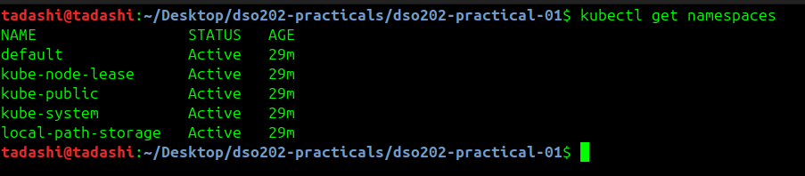

Listing the control-plane components because they run as Pods in kube-system


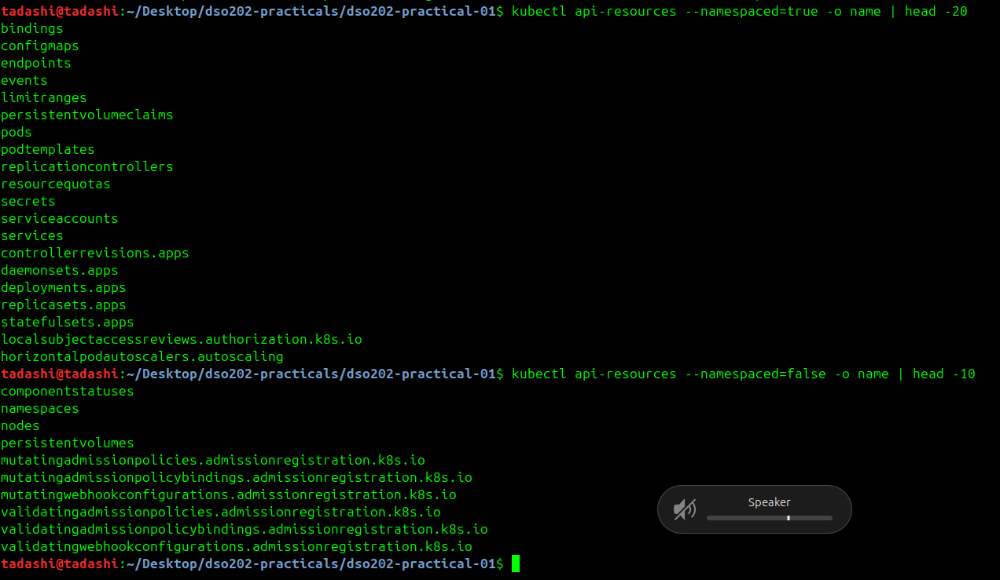

## Stage 3 — Namespaces, Resource Quotas, and Limit Ranges

Creating the namespace imperatively first, purely to see the imperative form, then delete it. The declarative version in Listing 2 is the graded artefact.

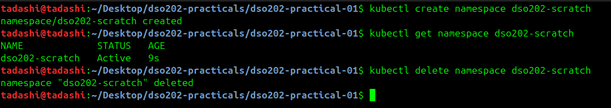

Generate a manifest from an imperative command without executing it. Compare the result with Listing 2 and note that Listing 2 adds labels, which the generated version does not.

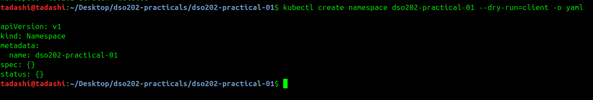

Copy Listing 2 into manifests/00-namespace.yaml and apply it.


Set the namespace as the default for the current context. Every subsequent command in this practical then omits -n.

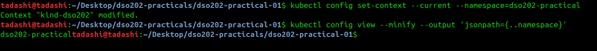

Copy Listing 3 into manifests/01-quota-and-limits.yaml and apply it. The file contains two objects separated by ---.


Read the quota. The Used column is what makes a quota useful during troubleshooting.


Read the limit range.

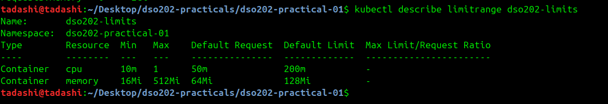

Prove that the LimitRange is doing its work. Start a Pod imperatively with no resource declaration at all, then read back what the cluster actually stored.

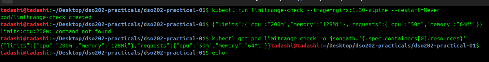

Delete the check Pod, since it is not part of the deliverable.

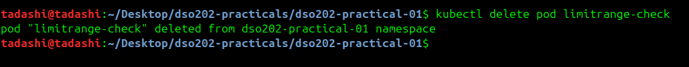

Checkpoint. kubectl get resourcequota,limitrange lists both objects, and the current context's default namespace is dso202-practical.

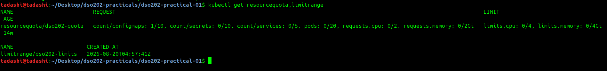

## Stage 4 — Pods

Creating a Pod with one command, then inspect it.

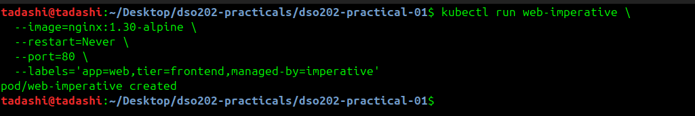

Watch the Pod reach Running. Press Ctrl+C to stop watching.


Delete the imperative Pod.

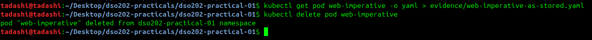

The declarative route

Step 5. Copy Listing 4 into manifests/02-pod-web.yaml and read the comments in it before applying. Then apply it.

Apply the same file a second time without changing it.

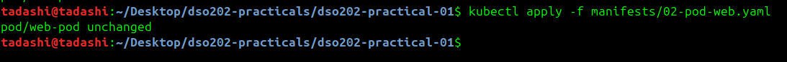

Confirm placement and the assigned Pod IP.


Confirm the resource declarations took effect.

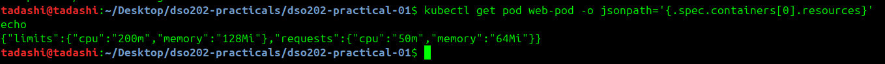

These values came from the manifest, not from the LimitRange. Verify by re-reading the quota:

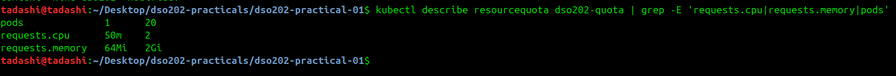

Describe the Pod and read the Events: section at the bottom.

```cmd
Events:
  Type    Reason     Age   From               Message
  ----    ------     ----  ----               -------
  Normal  Scheduled  39m   default-scheduler  Successfully assigned dso202-practical-01/web-pod to worker-node-2
  Normal  Pulled     39m   kubelet            spec.containers{web}: Container image "nginx:1.30-alpine" already present on machine and can be accessed by the pod
  Normal  Created    39m   kubelet            spec.containers{web}: Container created
  Normal  Started    39m   kubelet            spec.containers{web}: Container started
tadashi@tadashi:~/Desktop/dso202-practicals/dso202-practical-01$ 

```

Display labels alongside the Pod list.


Inside the container, run the following, then type exit:


Run a single command inside the container without an interactive session.

```cmd 
tadashi@tadashi:~/Desktop/dso202-practicals/dso202-practical-01$ kubectl exec web-pod -- nginx -v
nginx version: nginx/1.30.4
tadashi@tadashi:~/Desktop/dso202-practicals/dso202-practical-01$ 

```

Forward a local port to the Pod. This opens a tunnel from the host, through the API server, to the Pod. It is intended for debugging, never for exposing an application.

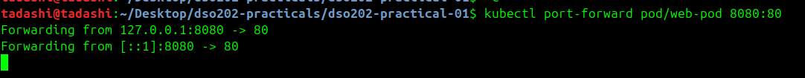


## Stage 5 — Deployments

The chain of ownership 

```cmd
Deployment  ──manages──►  ReplicaSet  ──manages──►  Pods
(strategy,                 (replica count,           (containers,
 revision history)          label selector)           volumes, probes)
```

Generate a Deployment manifest imperatively, purely for comparison. Then read Listing 8 and note everything the generated version omits: labels beyond the bare minimum, resource declarations, probes, a rollout strategy, and comments.


