## DSO202 Practical 1 Report: Kubernetes Workloads and Services

## Introduction

This practical demonstrates how a Kubernetes application is created, inspected, exposed, tested, deliberately broken, recovered, and rebuilt from version-controlled manifests. The work uses a three-node kind cluster named `dso202`: one control-plane node and two worker nodes. The application is an nginx web workload in the `dso202-practical-01` namespace.

The practical follows a declarative workflow. Imperative commands are used as short experiments or comparisons, while the numbered files under `manifests/` provide the reproducible source of truth. The numeric prefixes also express the dependency order: the namespace comes first, followed by policies, workloads, and Services.


## Stage 1 — Creating the Three-Node Cluster

The cluster configuration creates one control-plane node and two worker nodes. kind runs each Kubernetes node as a Docker container, while Kubernetes presents them as normal Nodes to the API server. The control-plane node hosts the API server, scheduler, controller manager, and etcd; the worker nodes run application workloads.

The configuration names the workers `worker-node-1` and `worker-node-2`, adds labels identifying their role and index, and maps host port `30080` to the control-plane container. That port mapping is required later by the NodePort Service.

Created the `dso202` cluster from the cluster configuration and confirmed kubectl was pointed at the new cluster.

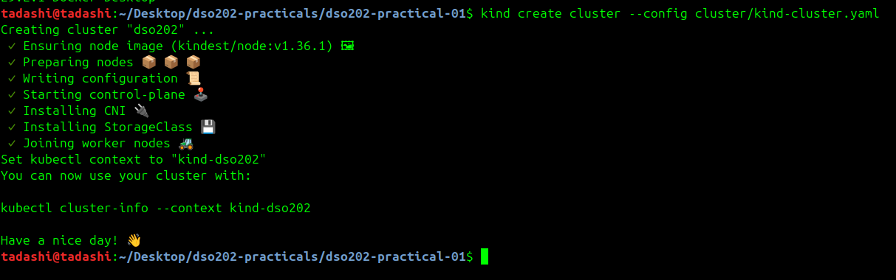

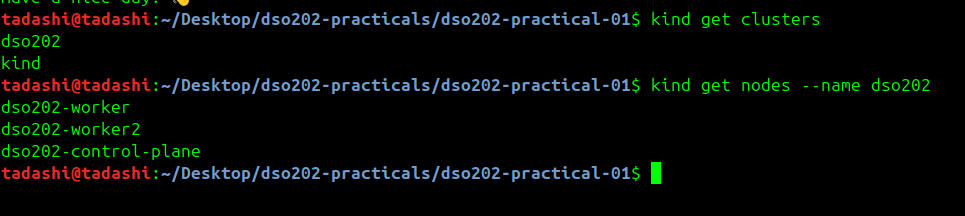

Checking if the same three nodes are working as a Docker containers.

This verifies both layers of the kind environment: Docker has created the node containers, and Kubernetes can use those containers as cluster nodes. Seeing all three containers confirms that the requested topology was created rather than a single-node default cluster.


Confirming if kubectl is pointing at the new cluster.

The active context must be `kind-dso202`. This prevents commands from being sent to a different cluster and makes the remaining evidence attributable to this practical.


### Check Point

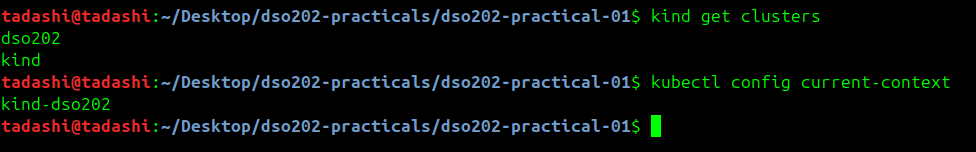

## Stage 2 — Inspecting the Cluster and Its Components

Checking the cluster where its control plane is.

This identifies the control-plane location and confirms that the API server and its supporting components are available. It is an administrative health check before application resources are created.


Listing all the nodes in the cluster.

All three Nodes should report `Ready`. The two worker Nodes are the intended placement targets for the nginx Pods, while the control-plane taint prevents ordinary application Pods from being scheduled there.


By adding -o wide to get more detail without switching to full YAML output.

Wide output adds node addresses, operating-system details, kernel information, and the container runtime. It connects a scheduling result to a physical kind node without the noise of complete YAML output.


Reading one node in detail and locating the labels applied by kind-cluster.yaml (Listing 1). Three things are important from the output. 

1. Labels : It includes dso202/node-role=worker and dso202/node-index=1, both set by kind-cluster.yaml (Listing 1)

```cmd
Labels:             beta.kubernetes.io/arch=amd64
                    beta.kubernetes.io/os=linux
                    dso202/node-index=1
                    dso202/node-role=worker
                    kubernetes.io/arch=amd64
                    kubernetes.io/hostname=worker-node-1
                    kubernetes.io/os=linux
```
2. Capacity and Allocatable : it is the total CPU and memory the node reports and how much of it Kubernetes will hand out

```cmd
Capacity:
  cpu:                8
  ephemeral-storage:  65739308Ki
  hugepages-1Gi:      0
  hugepages-2Mi:      0
  memory:             3715884Ki
  pods:               110
Allocatable:
  cpu:                8
  ephemeral-storage:  65739308Ki
  hugepages-1Gi:      0
  hugepages-2Mi:      0
  memory:             3715884Ki
  pods:               110
```
3. Non-terminated Pods : it shows every Pod currently placed on the node with its CPU and memory requests

```cmd
Non-terminated Pods:          (2 in total)
  Namespace                   Name                CPU Requests  CPU Limits  Memory Requests  Memory Limits  Age
  ---------                   ----                ------------  ----------  ---------------  -------------  ---
  kube-system                 kindnet-cr6v2       100m (1%)     100m (1%)   50Mi (1%)        50Mi (1%)      23m
  kube-system                 kube-proxy-g692g    0 (0%)        0 (0%)      0 (0%)           0 (0%)         23m
```

Listing the namespaces that exist before any work is done.

Namespaces provide the administrative boundary for names, quotas, and workload objects. This baseline confirms that the practical namespace has not yet been created.


Listing the control-plane components because they run as Pods in kube-system

The `kube-system` Pods are Kubernetes control-plane and node-agent components, not application Pods. Their presence confirms that DNS, networking, proxying, and cluster control services are running.

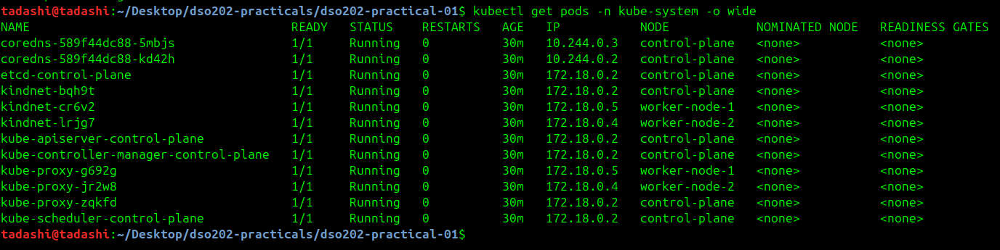


## Stage 3 — Namespaces, Resource Quotas, and Limit Ranges

Creating the namespace imperatively first, purely to see the imperative form, then delete it. The declarative version in Listing 2 is the graded artefact.

The imperative command demonstrates the API operation, but the committed manifest is the source of truth. It also adds labels and annotations that record the practical, management method, owner, and purpose.


Generate a manifest from an imperative command without executing it. Compare the result with Listing 2 and note that Listing 2 adds labels, which the generated version does not.


Copy Listing 2 into manifests/00-namespace.yaml and apply it.

This creates the namespace reproducibly. Every later namespaced object depends on this first manifest existing.

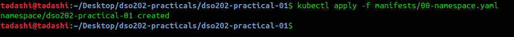

Set the namespace as the default for the current context. Every subsequent command in this practical then omits -n.


Copy Listing 3 into manifests/01-quota-and-limits.yaml and apply it. The file contains two objects separated by ---.

The ResourceQuota limits aggregate namespace consumption, including CPU, memory, Pod count, and selected object counts. The LimitRange supplies per-container defaults and enforces minimum and maximum values. Together these policies prevent both unbounded growth and incomplete resource declarations.

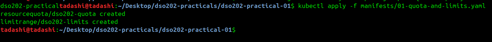

Read the quota. The Used column is what makes a quota useful during troubleshooting.

The Used/Hard values show the current budget rather than only the configured policy. A rejected Pod can be diagnosed by comparing its requests and object count with the remaining quota.

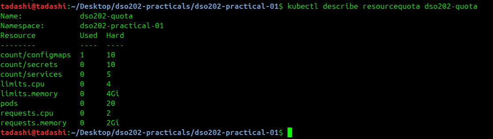

Read the limit range.


Prove that the LimitRange is doing its work. Start a Pod imperatively with no resource declaration at all, then read back what the cluster actually stored.

The returned Pod demonstrates admission-time defaulting: Kubernetes adds the LimitRange values to the container. This differs from ResourceQuota, which measures the namespace total and rejects objects when the total would exceed a hard limit.


Delete the check Pod, since it is not part of the deliverable.


Checkpoint. kubectl get resourcequota,limitrange lists both objects, and the current context's default namespace is dso202-practical.


## Stage 4 — Pods

Creating a Pod with one command, then inspect it.

This creates a standalone Pod directly. It is useful for observing a Pod specification, but it has no controller to recreate it after deletion or node failure. That limitation motivates the Deployment stage.


Watch the Pod reach Running. Press Ctrl+C to stop watching.

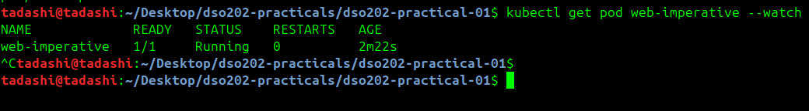

Delete the imperative Pod.


The declarative route

The manifest records the image, named HTTP port, labels, restart policy, and explicit CPU and memory requests and limits. The `app=web` and `tier=frontend` labels are important because the Deployment and Services use them for selection.

Step 5. Copy Listing 4 into manifests/02-pod-web.yaml and read the comments in it before applying. Then apply it.

Apply the same file a second time without changing it.


Confirm placement and the assigned Pod IP.

The node name proves that the scheduler selected a worker. The Pod IP belongs to the cluster Pod network and is temporary, so clients should use the stable Service address instead of connecting directly to it.

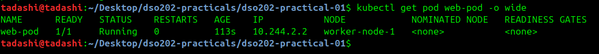

Confirm the resource declarations took effect.

Requests are reserved for scheduling, while limits are the maximum values permitted for the container. CPU overuse is throttled; memory overuse can terminate the container with an out-of-memory condition.


These values came from the manifest, not from the LimitRange. Verify by re-reading the quota:


Describe the Pod and read the Events: section at the bottom.

```cmd
Events:
  Type    Reason     Age   From               Message
  ----    ------     ----  ----               -------
  Normal  Scheduled  39m   default-scheduler  Successfully assigned dso202-practical-01/web-pod to worker-node-2
  Normal  Pulled     39m   kubelet            spec.containers{web}: Container image "nginx:1.30-alpine" already present on machine and can be accessed by the pod
  Normal  Created    39m   kubelet            spec.containers{web}: Container created
  Normal  Started    39m   kubelet            spec.containers{web}: Container started
tadashi@tadashi:~/Desktop/dso202-practicals/dso202-practical-01$ 

```

Display labels alongside the Pod list.

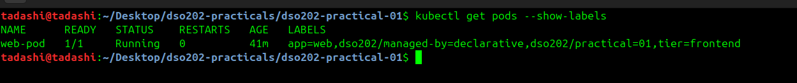

Inside the container, run the following, then type exit:


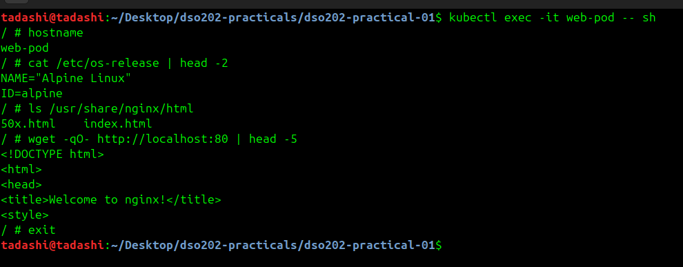

Run a single command inside the container without an interactive session.

```cmd 
tadashi@tadashi:~/Desktop/dso202-practicals/dso202-practical-01$ kubectl exec web-pod -- nginx -v
nginx version: nginx/1.30.4
tadashi@tadashi:~/Desktop/dso202-practicals/dso202-practical-01$ 

```

Forward a local port to the Pod. This opens a tunnel from the host, through the API server, to the Pod. It is intended for debugging, never for exposing an application.

Port-forwarding is temporary and tied to one Pod. It is appropriate for debugging, but it does not provide discovery, load balancing, or durable external access; those are Service responsibilities.


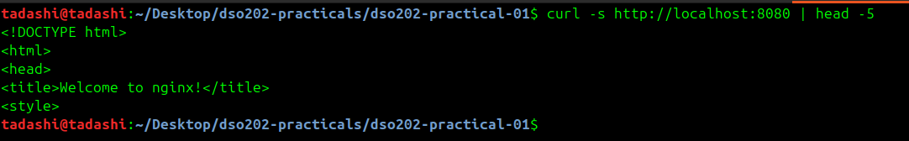

## Stage 5 — Deployments

The chain of ownership 

```cmd
Deployment  ──manages──►  ReplicaSet  ──manages──►  Pods
(strategy,                 (replica count,           (containers,
 revision history)          label selector)           volumes, probes)
```

The Deployment expresses the desired state. Its controller creates a ReplicaSet, and the ReplicaSet creates and counts Pods. This separation lets Kubernetes maintain the requested number of replicas and retain older Pod templates for rollback.

Generate a Deployment manifest imperatively, purely for comparison. Then read Listing 8 and note everything the generated version omits: labels beyond the bare minimum, resource declarations, probes, a rollout strategy, and comments.

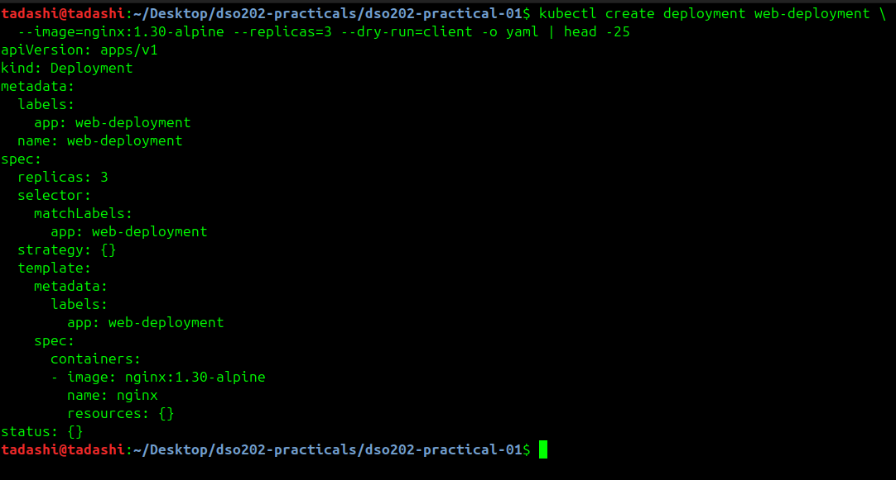

Copy Listing 5 into manifests/03-deployment-web.yaml and apply it.

The manifest requests three replicas and uses a selector that matches the labels in the Pod template. Its RollingUpdate strategy uses `maxUnavailable: 0` and `maxSurge: 1`, so a replacement becomes ready before an old replica is removed. Resource declarations and health probes make the rollout safer and observable.

```cmd
tadashi@tadashi:~/Desktop/dso202-practicals/dso202-practical-01$ kubectl apply -f manifests/03-deployment-web.yaml
deployment.apps/web-deployment created
tadashi@tadashi:~/Desktop/dso202-practicals/dso202-practical-01$ kubectl rollout status deployment/web-deployment
deployment "web-deployment" successfully rolled out
tadashi@tadashi:~/Desktop/dso202-practicals/dso202-practical-01$ 
```

Observe the three-level ownership chain in the cluster.

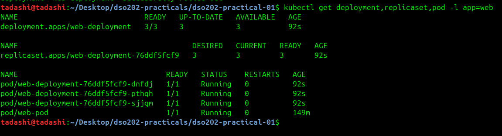

Confirm the ownership relationship rather than inferring it from names.

```cmd 
tadashi@tadashi:~/Desktop/dso202-practicals/dso202-practical-01$ kubectl get replicaset -l app=web -o jsonpath='{.items[0].metadata.ownerReferences[0].kind}/{.items[0].metadata.ownerReferences[0].name}{"\n"}'
Deployment/web-deployment
tadashi@tadashi:~/Desktop/dso202-practicals/dso202-practical-01$ 

```

Confirm the scheduler spread the replicas across the worker nodes.

```cmd 
tadashi@tadashi:~/Desktop/dso202-practicals/dso202-practical-01$ kubectl get pods -l app=web -o wide --no-headers | awk '{print $1, $7}'
web-deployment-76ddf5fcf9-dnfdj worker-node-1
web-deployment-76ddf5fcf9-pthqh worker-node-2
web-deployment-76ddf5fcf9-sjjqm worker-node-2
tadashi@tadashi:~/Desktop/dso202-practicals/dso202-practical-01$ 
```

Demonstrate self-healing. Delete one Pod and immediately list them again

Deleting a managed Pod does not reduce the Deployment's desired replica count. The ReplicaSet notices the difference and creates a replacement, demonstrating reconciliation and self-healing rather than merely restarting the original Pod.

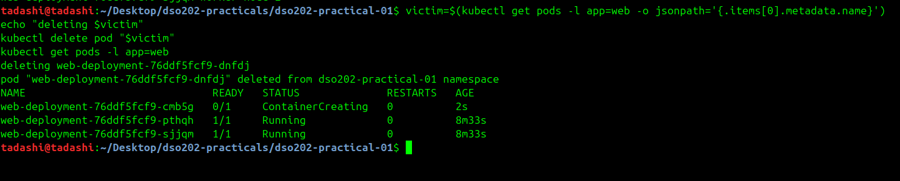

Scale imperatively, then read the result.

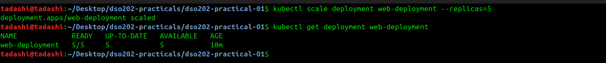


Return to three replicas the declarative way, by re-applying the unmodified manifest.

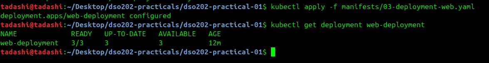

Rolling update and rollback

Changing the image changes the Pod template hash. The Deployment creates a new ReplicaSet and gradually transfers the three replicas to it. The old ReplicaSet remains at zero replicas so that its template can be restored if the new version is unsuitable.

change the image version. nginx:1.31-alpine is the current mainline release; nginx:1.30-alpine is the stable release used so far.

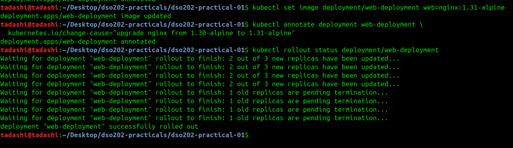

Confirm two ReplicaSets now exist, one of them scaled to zero.

```cmd
tadashi@tadashi:~/Desktop/dso202-practicals/dso202-practical-01$ kubectl get replicaset -l app=web
NAME                        DESIRED   CURRENT   READY   AGE
web-deployment-76ddf5fcf9   0         0         0       19m
web-deployment-ddd46bfd     3         3         3       2m53s
tadashi@tadashi:~/Desktop/dso202-practicals/dso202-practical-01$ 
```

Read the revision history
```cmd
tadashi@tadashi:~/Desktop/dso202-practicals/dso202-practical-01$ kubectl rollout history deployment/web-deployment
deployment.apps/web-deployment 
REVISION  CHANGE-CAUSE
1         upgrade nginx from 1.30-alpine to 1.31-alpine
2         upgrade nginx from 1.30-alpine to 1.31-alpine

tadashi@tadashi:~/Desktop/dso202-practicals/dso202-practical-01$ 
```

Roll back to the previous revision and confirm.

```cmd
tadashi@tadashi:~/Desktop/dso202-practicals/dso202-practical-01$ kubectl rollout undo deployment/web-deployment
deployment.apps/web-deployment rolled back
tadashi@tadashi:~/Desktop/dso202-practicals/dso202-practical-01$ kubectl rollout status deployment/web-deployment
deployment "web-deployment" successfully rolled out
tadashi@tadashi:~/Desktop/dso202-practicals/dso202-practical-01$ kubectl get deployment web-deployment -o jsonpath='{.spec.template.spec.containers[0].image}{"\n"}'
nginx:1.30-alpine
tadashi@tadashi:~/Desktop/dso202-practicals/dso202-practical-01$ 

```
Demonstrate a failed rollout and recover from it. This is deliberate: a rollout that cannot succeed must be recognised quickly.

The deliberately invalid image tag cannot be pulled, so the new Pod enters `ImagePullBackOff`. Because `maxUnavailable` is zero, the Deployment keeps the existing healthy replicas serving while the new ReplicaSet cannot progress. This is why rollout status and individual Pod status must be checked together.

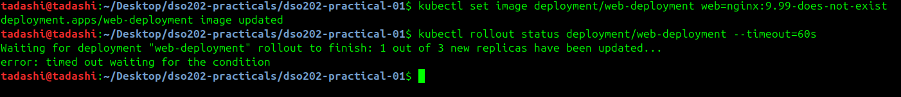

The pasted terminal image below records this state concisely. Three Pods are `1/1 Running`, while `web-deployment-67499b7844-CCv2` is `0/1 ImagePullBackOff`. The zero restart count indicates that the container never started successfully; this is an image retrieval failure rather than an application process repeatedly crashing. The three healthy replicas explain why the Service can continue serving traffic during the failed rollout.


Diagnose and undo.

The failed ReplicaSet is identified from the Pod name and its image can be checked with `kubectl describe pod` or the ReplicaSet listing. Rolling the Deployment back restores the last known-good nginx image and returns the active ReplicaSet to three ready replicas.

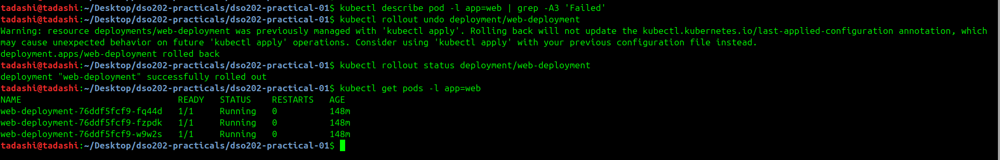

Copy Listing 6 into manifests/04-service-clusterip.yaml and apply it

The ClusterIP Service creates a stable virtual IP and DNS name. Its selector targets Pods labelled `app=web,tier=frontend`, and its named `targetPort: http` forwards requests to the named container port. Clients inside the cluster can use the short DNS name `web-clusterip`.

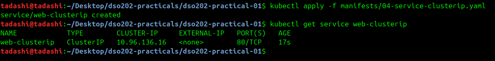

Read the EndpointSlice the controller generated. This is the list of addresses the Service will actually send traffic to.

The EndpointSlice is the operational answer to the question “where will this Service send traffic?” It should contain the three ready Pod IPs. If a Pod fails readiness, its address is removed from the ready endpoints even though the Pod may remain Running.

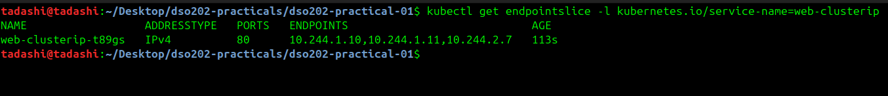

Send requests through the Service.

Requests sent through the Service test the complete in-cluster path: client Pod, cluster DNS, Service virtual IP, kube-proxy rules, and a ready nginx endpoint. This verifies the discovery and routing abstraction used by applications rather than testing a temporary Pod IP directly.

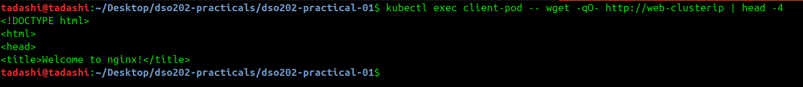

Demonstrate that readiness gates traffic. Break the readiness probe on one Pod and watch it leave the EndpointSlice.

The readiness probe in Listing 8 requests /index.html, so deleting that file makes the probe fail. Its liveness probe is a TCP check, which keeps passing, so the container is not restarted.

This separates readiness from liveness. Readiness controls whether traffic is sent to a Pod; liveness controls whether Kubernetes restarts the container. A failed readiness check can therefore remove an endpoint while leaving the process running for diagnosis.

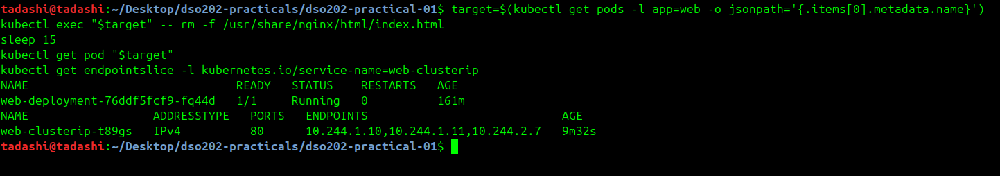

Demonstrate the most common Service fault: a selector that matches nothing.

A Service can exist and receive a ClusterIP while still routing no traffic. A selector typo produces an empty EndpointSlice, so checking the selector and EndpointSlice is the quickest way to distinguish a Service configuration problem from an nginx problem.

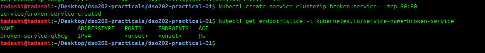

Applied into manifests/05-service-nodeport.yaml and apply it. It fixes nodePort: 30080, which is the port Listing 1 published from the control-plane container to the host.

The NodePort Service retains the in-cluster Service behavior and additionally opens port `30080` on every Kubernetes node. kind publishes that port from the control-plane container to `localhost:30080`, allowing a host request to reach a ready nginx Pod on either worker.

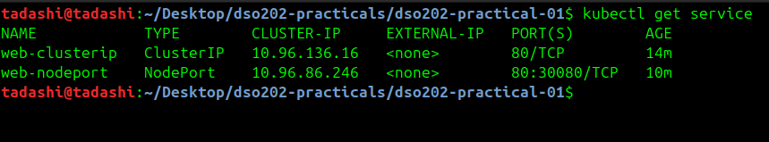

## Stage 7 — Cleanup, Evidence, and Reproducibility

Capture final evidence before deleting anything.

The final evidence captures the healthy end state: the client Pod, three ready Deployment Pods, both Services, the Deployment, its ReplicaSets, quota usage, and the EndpointSlices. Capturing this state before cleanup preserves proof of the completed practical after the live objects are removed.


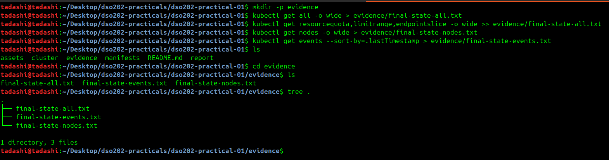

Delete the workload objects declaratively, in reverse order of creation. Deleting from the same files that created the objects is the check that no object was created outside version control.

Reverse-order deletion respects dependencies and demonstrates that the repository contains the definitions needed to remove the workload. The namespace and policy objects can remain until workload cleanup has been verified.


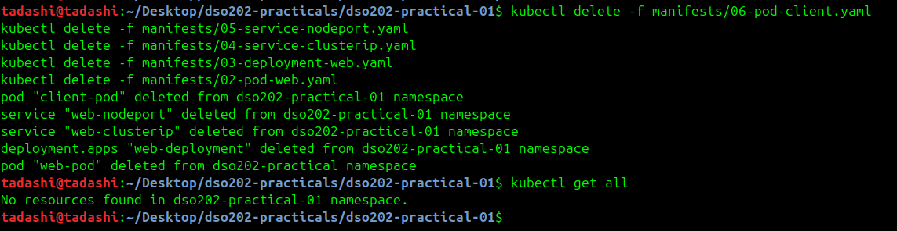

Rebuild everything from the repository in one command, to prove reproducibility. kubectl apply -f accepts a directory and applies the files in lexical order, which is exactly why the filenames are numbered.

Reapplying the directory reconstructs the namespace, policies, Pods, Deployment, and Services from the YAML files. A successful rebuild shows that the practical is not dependent on hidden imperative changes left in the cluster.

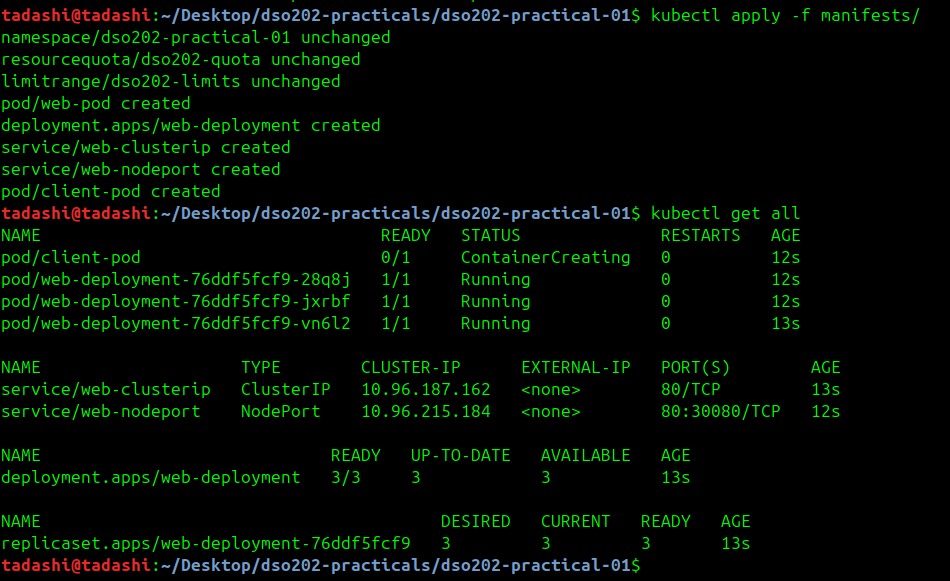

## Conclusion

The practical demonstrates the main Kubernetes control loops. Nodes provide capacity, admission policies constrain and default workloads, the scheduler places Pods, ReplicaSets maintain replica counts, Deployments manage revisions, readiness controls traffic, and Services provide stable discovery and routing. The failed image rollout shows that a workload can be partially unhealthy while the application remains available when the rollout strategy protects ready replicas. Cleanup and rebuild then confirm that the final result can be reproduced from the repository rather than from undocumented manual actions.


