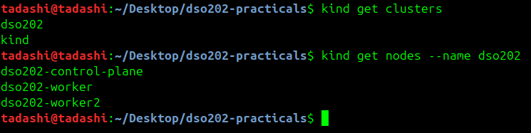
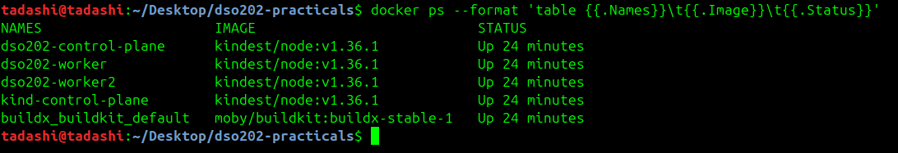
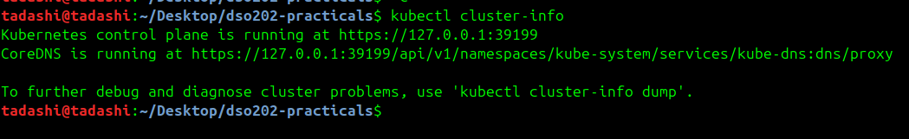
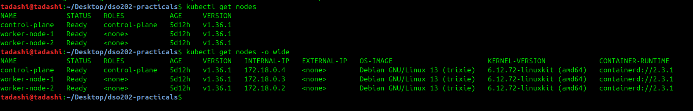

# DSO202 — Practical 1 Report
### Setting Up a Local Kubernetes Cluster with kind, and Deploying First Workloads

## Stage 1 : 
Created the cluster using the command where it spins up three docker containers that will be working like a Kubernetes node, one control pane node and two worker nodes. 
```cmd 
kind create cluster --config cluster/kind-cluster.yaml
```
Listed all the clusters to confirm that cluster is registered. 


---
This three confirms that the three container proofs that the Kubernetes cluster is the docker container


---
kubectl is pointing to the new cluster .
```cmd 
tadashi@tadashi:~/Desktop/dso202-practicals$ kubectl config current-context
kind-dso202
tadashi@tadashi:~/Desktop/dso202-practicals$ 
```
---
## Stage 2 : 
Checking the clusters where the API server is listening which include the IP address and port.


---
Listing every nodes in the cluster and theie status ( Ready/NotReady). Plus listed the internal IP, OS image, kernal version, container runtime on the nodes in the cluster.
