# DSO202 Practical 2 — Persistent Storage for a Stateful Application in Kubernetes

## 1. Objective

The purpose of this practical is to learn how Kubernetes keeps data alive when the Pods that use it are deleted, rescheduled or replaced. I built a three-node kind cluster and worked through the storage objects one layer at a time:

- **Static provisioning** — describing an existing host directory to Kubernetes with a PersistentVolume (PV) and requesting it with a PersistentVolumeClaim (PVC), and observing what the `Retain` reclaim policy does.
- **Dynamic provisioning** — letting a StorageClass and its provisioner (`rancher.io/local-path`) create volumes on demand, and observing `WaitForFirstConsumer`, the unenforced capacity, the rejected resize and the `Delete` reclaim policy.
- **The Deployment anti-pattern** — showing on purpose why a Deployment cannot own state.
- **StatefulSets** — stable Pod names, one PVC per ordinal, per-Pod DNS via a headless Service, ordered creation/termination, retention of claims on scale-down and delete, and a partitioned rolling update.
- **A real database** — PostgreSQL 18 as a StatefulSet on a `Retain` StorageClass, with credentials in a Secret, a readiness probe, and data that survives Pod deletion.
- **Cleanup** — seeing which storage survives each deletion and why.

Descriptor coverage: **LO4** (persistent storage with Kubernetes volumes) as the primary outcome, reinforcing **LO2/LO3** (deploying resources declaratively and using kubectl) and **LO1** (cluster architecture — the storage provisioner add-on).

---

## 2. Environment

| Item | Value | Verify with |
| --- | --- | --- |
| Host OS | Ubuntu 25.04, Linux 6.14.0-37-generic | `uname -sr; lsb_release -ds` |
| Docker | Docker Desktop, Docker 29.2.1 (build a5c7197) | `docker --version; docker info --format '{{.OperatingSystem}}'` |
| kind | `kind version 0.20.0` reported by the binary on `PATH` | `kind --version` |
| kubectl (client) | v1.36.3 | `kubectl version` |
| Cluster Kubernetes version | v1.36.1 (node image `kindest/node:v1.36.1`) | `kubectl get nodes -o wide` |
| Container runtime on nodes | containerd 2.3.1 | `kubectl get nodes -o wide` |
| Cluster name / context | `dso202-p2` / `kind-dso202-p2` | `kubectl config current-context` |
| Nodes | `control-plane`, `worker-node-1`, `worker-node-2` | `kubectl get nodes` |
| PostgreSQL image | `postgres:18-alpine` (server reports PostgreSQL 18.6) | `kubectl exec postgres-0 -- postgres --version` |
| Other images | `busybox:1.37`, `nginx:1.30-alpine` → `nginx:1.31-alpine` | `kubectl get pods -o custom-columns=NAME:.metadata.name,IMAGE:.spec.containers[0].image` |
| Host directory for the static PV | `/home/tadashi/dso202-p2-storage` (see note) | `ls -ld /home/tadashi/dso202-p2-storage` |

**Deviation from the guide.** Docker runs as *Docker Desktop* (a LinuxKit VM, see the `6.12.72-linuxkit` kernel in `kubectl get nodes -o wide`). Docker Desktop only shares certain host paths into its VM by default, and `/tmp` on the host is not the same `/tmp` the VM sees, so I changed the `extraMounts.hostPath` in `cluster/kind-cluster.yaml` from `/tmp/dso202-p2-storage` to `/home/tadashi/dso202-p2-storage`. Every command below that the guide writes as `/tmp/dso202-p2-storage` was run against `/home/tadashi/dso202-p2-storage`. The standard (non-fallback) cluster configuration was used.

Full output: `evidence/environment.txt`.

---

## 3. Procedure and Observations

Every command in this section was run from the repository root with the active namespace set to `dso202-practical-02`. The raw output for each stage is saved in `evidence/`.

### 3.0 Stage 0 — Prerequisites

#### Step 1 — Tool versions

Checking the required CLI tools like docker, kind, and kubectl are installed, accessible in the system path and functioning properly.

```bash
docker --version
kind --version
kubectl version --client
```

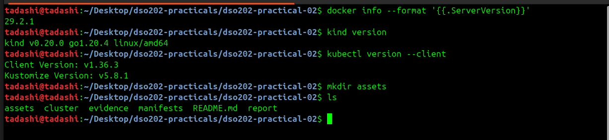

Output shows the version strings for Docker, Kind and the kubectl client without throwing any errors.

#### Step 3 — Host directory for the static volume

Created the host directory that serves as host-path persistent storage mounted into the first worker node.

```bash
mkdir -p /home/tadashi/dso202-p2-storage
ls -ld /home/tadashi/dso202-p2-storage
```

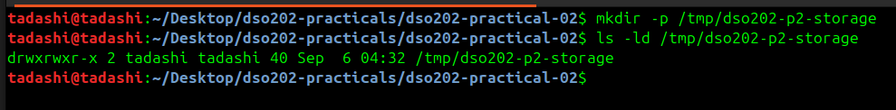

The directory is created without errors and `ls -ld` confirms standard user read/write/execute permissions (`drwxr-xr-x`).

#### Step 4 — Free disk space

Checked available storage on the partition where Docker images and containers reside, to ensure there is enough disk space for new cluster nodes and images.

```bash
df -h /
```

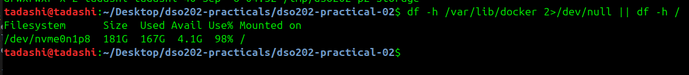

The output shows the available disk space on the host system (more than the ~3 GB the practical needs).

### 3.1 Stage 1 — Cluster, Namespace, and the Storage Landscape

#### Step 1 — Create the cluster

Deployed a multi-node Kubernetes cluster inside Docker containers using kind and the configuration file `cluster/kind-cluster.yaml`.

```bash
kind create cluster --config cluster/kind-cluster.yaml
```

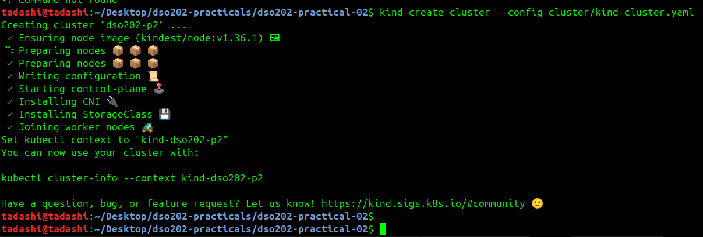

kind automatically installs a default local storage provisioner add-on alongside essential components like the Container Network Interface (CNI).

#### Step 2 — Map Node names to Docker containers

Listed the cluster nodes using kubectl and compared them against running Docker containers using `docker ps`.

```bash
kind get clusters
kubectl get nodes -o wide
docker ps --format '{{.Names}}'
```

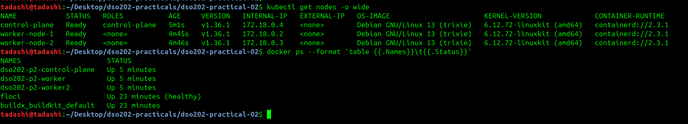

| Node (`kubectl get nodes`) | Docker container (`docker ps`) |
| --- | --- |
| `control-plane` | `dso202-p2-control-plane` |
| `worker-node-1` | `dso202-p2-worker` |
| `worker-node-2` | `dso202-p2-worker2` |

#### Step 3 — Confirm the host mount on worker-node-1

Used `docker exec` to run `ls -ld` inside the worker-node-1 container, verifying that the host directory was mounted at `/mnt/dso202-static`.

```bash
docker exec dso202-p2-worker ls -ld /mnt/dso202-static
```

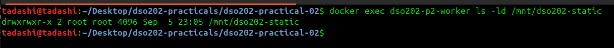

#### Step 4 — Namespace, quota and the retaining StorageClass

Applied the core manifests to create the working namespace `dso202-practical-02` and set it as the active context default. Created both a ResourceQuota/LimitRange and the custom StorageClass `dso202-retain`.

```bash
kubectl apply -f manifests/00-namespace.yaml
kubectl config set-context --current --namespace=dso202-practical-02
kubectl apply -f manifests/01-quota-and-limits.yaml
kubectl apply -f manifests/02-storageclass-retain.yaml
```

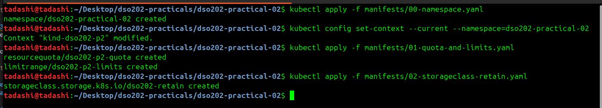

The active namespace shortens subsequent kubectl commands by eliminating the need to pass `-n dso202-practical-02` every time.

#### Step 5 — Inspect the quota

```bash
kubectl describe resourcequota dso202-p2-quota
```

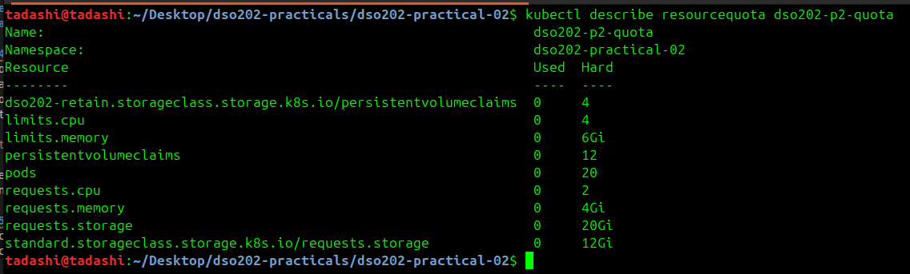

The command verifies that the storage enforcement limits are active — caps on total PVC count (12), overall requested storage (20Gi) and the per-StorageClass caps.

#### Step 6 — Compare StorageClasses

```bash
kubectl get storageclass
```

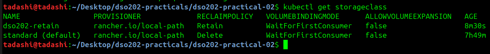

The output compares the default `standard` class against the new `dso202-retain` class. Both use `rancher.io/local-path` and `WaitForFirstConsumer` with `ALLOWVOLUMEEXPANSION=false`; they differ only in `RECLAIMPOLICY` (`Delete` vs `Retain`).

#### Step 7 — Locate the provisioner

```bash
kubectl get pods -n local-path-storage
```

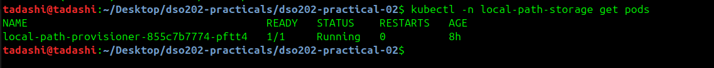

This identifies the running pod that watches for PersistentVolumeClaims and creates the backing directories on the nodes.

#### Step 8 — Where dynamic volumes live on a node

```bash
kubectl get configmap local-path-config -n local-path-storage -o jsonpath='{.data.config\.json}'
```

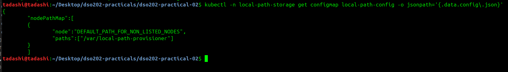

The on-node directory for every dynamically provisioned volume is `/var/local-path-provisioner`.

### 3.2 Stage 2 — Static Provisioning and the Meaning of Retain

Evidence: `evidence/stage2-static-provisioning.txt`

#### Step 1 — Create the PersistentVolume

```bash
kubectl apply -f manifests/03-pv-static.yaml
kubectl get pv
```

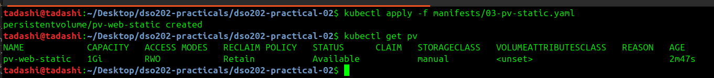

The PV status is `Available`: it exists in the cluster and is waiting for a matching claim.

#### Step 2 — The fields that constrain scheduling

```bash
kubectl get pv pv-web-static -o jsonpath='{.spec.hostPath.path}{"\n"}'
kubectl get pv pv-web-static -o jsonpath='{.spec.nodeAffinity}{"\n"}'
```

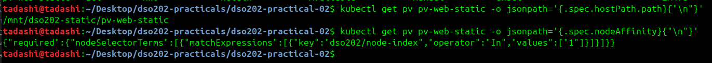

The volume is tied to worker-node-1 via a `nodeAffinity` rule (`dso202/node-index=1`), so any Pod using it can only run on that node.

#### Step 3 — Claim it; observe immediate binding

```bash
kubectl apply -f manifests/04-pvc-static.yaml
kubectl get pvc
```
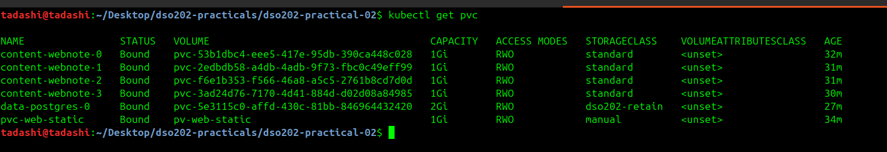

The claim went straight to `Bound` because a matching `Available` PV with class name `manual`, ≥1Gi and `RWO` already existed.

#### Step 4 — `manual` is not a real StorageClass

```bash
kubectl get storageclass manual
```
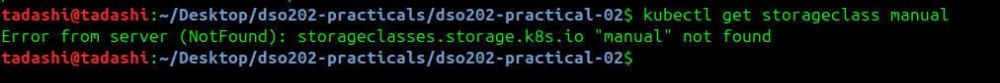

`manual` is only a matching label between the PV and the PVC, so no provisioner and no binding mode is involved — which is why binding was immediate.

#### Step 5 — Writer Pod; the volume chooses the node

```bash
kubectl apply -f manifests/05-pod-static-writer.yaml
kubectl wait --for=condition=Ready pod/static-writer --timeout=90s
kubectl get pod static-writer -o wide
```
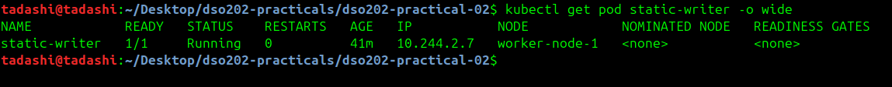

The Pod landed on `worker-node-1` even though Listing 7 has no `nodeSelector` — the PV's node affinity placed it there.

#### Step 6 — Same file inside the container and on the host

```bash
kubectl exec static-writer -- cat /data/ledger.txt
cat /home/tadashi/dso202-p2-storage/pv-web-static/ledger.txt
```
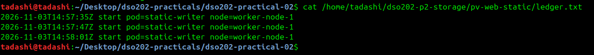

The identical line appears in both places: the PV is just a host directory mounted into the container.

#### Step 7 — The volume outlives the Pod

```bash
kubectl delete pod static-writer
kubectl apply -f manifests/05-pod-static-writer.yaml
kubectl wait --for=condition=Ready pod/static-writer --timeout=90s
kubectl exec static-writer -- cat /data/ledger.txt
```


Two lines — the first was written by a Pod that no longer exists.

#### Step 8 — Delete the claim; the PV becomes `Released`

```bash
kubectl delete pod static-writer
kubectl delete pvc pvc-web-static
kubectl get pv
```

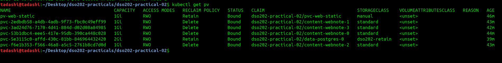

The PV is `Released`, not `Available`, and still names the deleted claim: `Retain` will not hand one workload's data to the next claim automatically.

#### Step 9 — Deleting the PV object deletes no data

```bash
cat /home/tadashi/dso202-p2-storage/pv-web-static/ledger.txt
kubectl delete pv pv-web-static
ls -l /home/tadashi/dso202-p2-storage/pv-web-static/
```

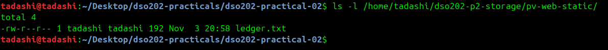

Deleting the PV removed an API object only; `ledger.txt` is untouched on the host.

#### Step 10 — Recreate PV, PVC and Pod; old data is adopted

```bash
kubectl apply -f manifests/03-pv-static.yaml
kubectl apply -f manifests/04-pvc-static.yaml
kubectl apply -f manifests/05-pod-static-writer.yaml
kubectl wait --for=condition=Ready pod/static-writer --timeout=90s
kubectl exec static-writer -- cat /data/ledger.txt
```
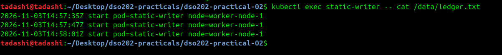

**Checkpoint met:** three lines — a new PV, a new PVC and a new Pod adopted data written before any of them existed.

### 3.3 Stage 3 — Dynamic Provisioning

Evidence: `evidence/stage3-dynamic-provisioning.txt`

#### Steps 1–2 — A claim that waits

```bash
kubectl apply -f manifests/06-pvc-dynamic.yaml
kubectl get pvc dynamic-data
kubectl describe pvc dynamic-data | tail -n 6
```

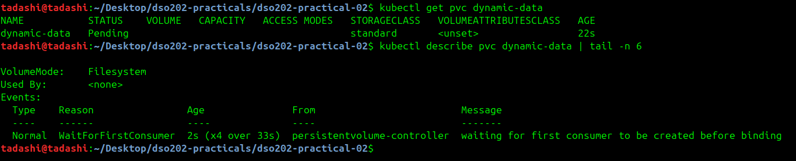

`Pending` here is correct behaviour: the `standard` class uses `WaitForFirstConsumer`, so no volume is created until a Pod using the claim is scheduled.

#### Step 3 — A consumer triggers provisioning

```bash
kubectl apply -f manifests/07-pod-dynamic-writer.yaml
kubectl wait --for=condition=Ready pod/dynamic-writer --timeout=120s
kubectl get pvc dynamic-data
kubectl get pv
```

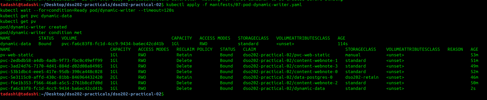

A PV named `pvc-<claim UID>` was created automatically, with reclaim policy `Delete` inherited from the `standard` class.

#### Step 4 — Find the volume on the node

```bash
kubectl get pod dynamic-writer -o wide
docker exec dso202-p2-worker ls /var/local-path-provisioner
```

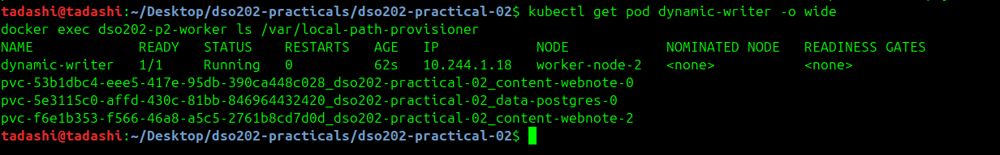

The Pod was on `worker-node-1` (container `dso202-p2-worker`), and the directory name encodes PV name, namespace and claim name.

#### Step 5 — First uncomfortable truth: size is not enforced

```bash
kubectl exec dynamic-writer -- df -h /data
```


The claim asked for 1Gi but the container sees the whole 62.7G node disk (the Docker Desktop VM disk) — local-path records capacity but does not enforce it.

#### Step 6 — Second uncomfortable truth: no expansion

```bash
kubectl patch pvc dynamic-data --type merge -p '{"spec":{"resources":{"requests":{"storage":"2Gi"}}}}'
```

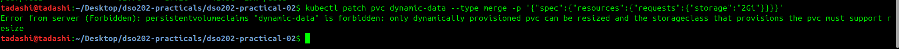

The API server rejected the resize because the class has `allowVolumeExpansion: false`.

#### Step 7 — `Delete` removes the data

```bash
kubectl exec dynamic-writer -- cat /data/ledger.txt
kubectl delete pod dynamic-writer
kubectl delete pvc dynamic-data
kubectl get pv
docker exec dso202-p2-worker ls /var/local-path-provisioner
```
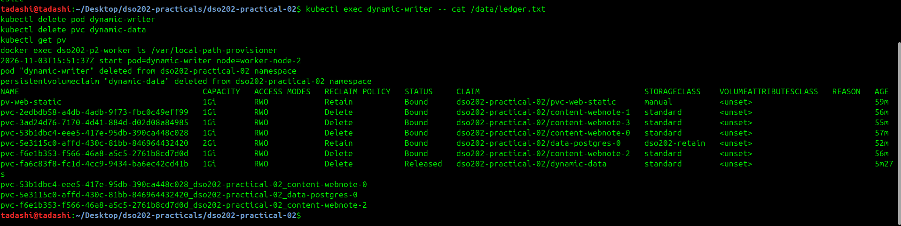

**Checkpoint met:** the claim, the dynamic PV and the node directory are all gone — the opposite of Stage 2, decided by one field (`reclaimPolicy`) on the StorageClass.

### 3.4 Stage 4 — Why a Deployment Cannot Own State (deliberate failure)

Evidence: `evidence/stage4-deployment-shared-pvc.txt`

> This stage is an intentional anti-pattern. The output below is **not** a successful outcome — it is the record of three ways a Deployment fails as a home for stateful data.

#### Step 1 — Three replicas, one claim

```bash
kubectl apply -f manifests/08-deployment-shared-pvc.yaml
kubectl rollout status deployment/shared-writer --timeout=180s
kubectl get pods -l app=shared-writer -o custom-columns=NAME:.metadata.name,NODE:.spec.nodeName
```
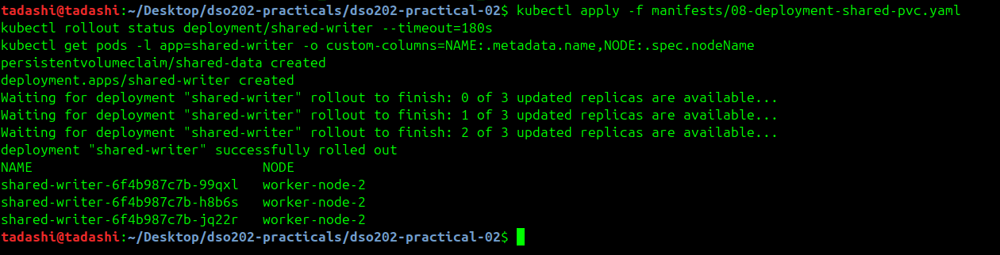

**Observation 1 — the volume dictated placement.** All three replicas were forced onto `worker-node-2`, although the Deployment asks for no node. The first replica caused the local-path volume to be created on worker-node-1, and that volume's node affinity then excluded every other node for the remaining replicas.

#### Step 2 — One file, not three

```bash
kubectl exec deploy/shared-writer -- cat /data/visitors.log
```

```bash
tadashi@tadashi:~/Desktop/dso202-practicals/dso202-practical-02$ kubectl exec deploy/shared-writer -- cat /data/visitors.log
2026-11-03T16:02:18Z pod=shared-writer-6f4b987c7b-h8b6s node=worker-node-2
2026-11-03T16:02:18Z pod=shared-writer-6f4b987c7b-jq22r node=worker-node-2
2026-11-03T16:02:19Z pod=shared-writer-6f4b987c7b-99qxl node=worker-node-2
tadashi@tadashi:~/Desktop/dso202-practicals/dso202-practical-02$ 

```
**Observation 2 — there is one set of data, not three.** All replicas wrote into the same file. For a database this would mean three server processes writing one data directory, which corrupts it. A Deployment cannot give each replica its own volume because the claim is named once in the shared Pod template.

#### Step 3 — Identity does not survive

```bash
kubectl delete pod -l app=shared-writer --field-selector status.phase=Running --wait=false
sleep 15
kubectl get pods -l app=shared-writer -o custom-columns=NAME:.metadata.name,NODE:.spec.nodeName
```

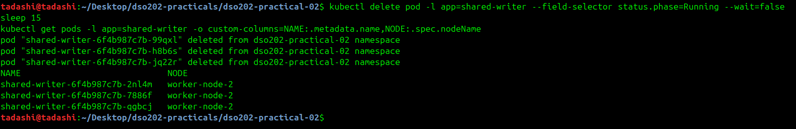

**Observation 3 — no replica has a stable identity.** Every replacement has a new random suffix, so nothing (a peer, a monitor, an application) can refer to "replica 1" and mean the same member before and after a restart.

#### Step 4 — Hidden failure, then remove the experiment

```bash
kubectl delete -f manifests/08-deployment-shared-pvc.yaml
kubectl get pvc
```
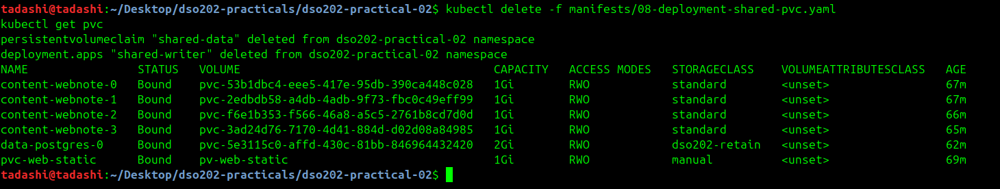

On this cluster the misconfiguration ran without errors because `ReadWriteOnce` restricts a volume to one *node*, not one Pod. On a cloud cluster with a zonal network disk, replicas scheduled to other nodes would hang in `ContainerCreating` with a *Multi-Attach error*.

### 3.5 Stage 5 — StatefulSets and Stable Identity

Evidence: `evidence/stage5-statefulset-identity.txt`

#### Step 1 — Headless Service first

```bash
kubectl apply -f manifests/09-service-webnote.yaml
kubectl get service webnote
```
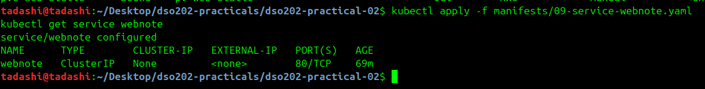

`CLUSTER-IP: None` — no virtual IP and no load balancing; the Service exists only to publish per-Pod DNS records.

#### Step 2 — Ordered creation

```bash
kubectl apply -f manifests/10-statefulset-webnote.yaml
kubectl get pods -l app=webnote -w 
```

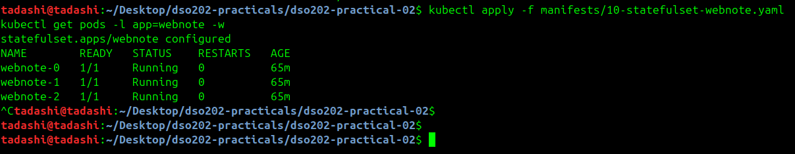

`webnote-1` was not created until `webnote-0` was `1/1 Ready`, and `webnote-2` only after `webnote-1` — the `OrderedReady` policy.

#### Step 3 — One claim per ordinal

```bash
kubectl get pvc -l app=webnote
```

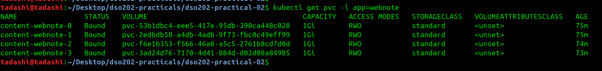

Three separate claims from one `volumeClaimTemplate`, named `<template>-<statefulset>-<ordinal>`.

#### Step 4 — Placement is free again

```bash
kubectl get pods -l app=webnote -o custom-columns=NAME:.metadata.name,NODE:.spec.nodeName,IP:.status.podIP
```
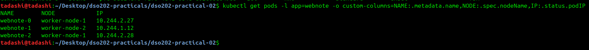

Unlike Stage 4, replicas are spread over both workers because each has its own volume.

#### Step 5 — Per-Pod DNS

```bash
kubectl apply -f manifests/11-pod-client.yaml
kubectl wait --for=condition=Ready pod/client --timeout=90s
kubectl exec client -- nslookup webnote.dso202-practical-02.svc.cluster.local
kubectl exec client -- nslookup webnote-1.webnote.dso202-practical-02.svc.cluster.local
```

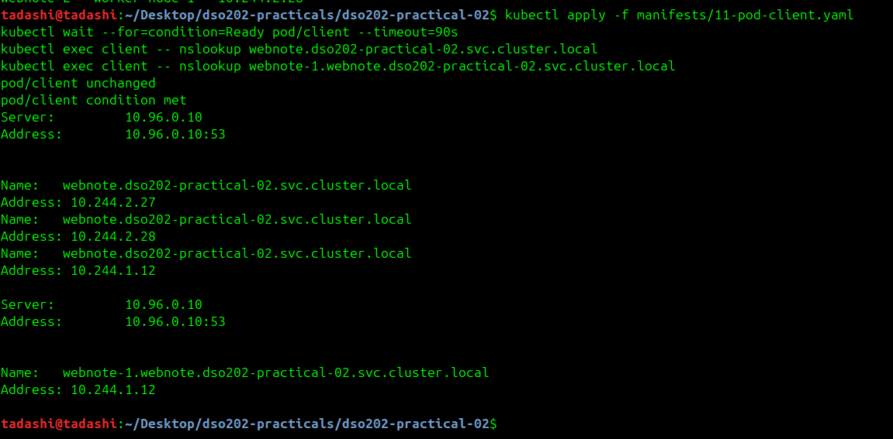

The Service name returns all three Pod IPs, and the per-Pod name `webnote-1.webnote...` returns exactly one Pod's IP.

#### Step 6 — Fetch one specific Pod

```bash
kubectl exec client -- wget -qO- http://webnote-1.webnote.dso202-practical-02.svc.cluster.local
```
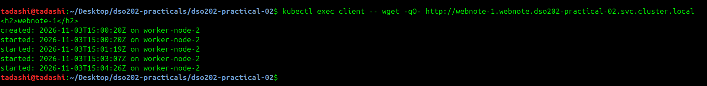

#### Step 7 — EndpointSlice lists Pod IPs directly

```bash
kubectl get endpointslice -l kubernetes.io/service-name=webnote
```

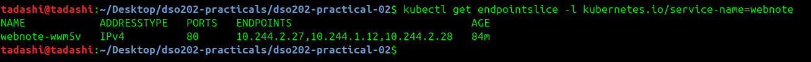

#### Step 8 — Volumes are private

```bash
kubectl exec webnote-0 -- sh -c 'echo "note added by hand in Stage 5" >> /usr/share/nginx/html/index.html'
kubectl exec client -- wget -qO- http://webnote-0.webnote.dso202-practical-02.svc.cluster.local
kubectl exec client -- wget -qO- http://webnote-1.webnote.dso202-practical-02.svc.cluster.local
```

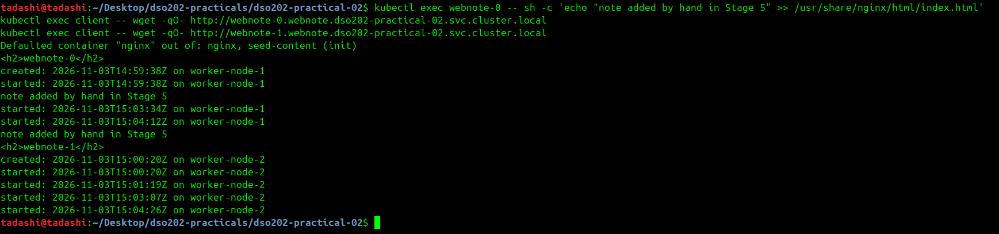


#### Step 9 — Identity and storage survive deletion

```bash
kubectl delete pod webnote-1
kubectl wait --for=condition=Ready pod/webnote-1 --timeout=120s
kubectl get pod webnote-1 -o custom-columns=NAME:.metadata.name,NODE:.spec.nodeName,IP:.status.podIP
kubectl get pvc content-webnote-1
kubectl exec client -- wget -qO- http://webnote-1.webnote.dso202-practical-02.svc.cluster.local
```
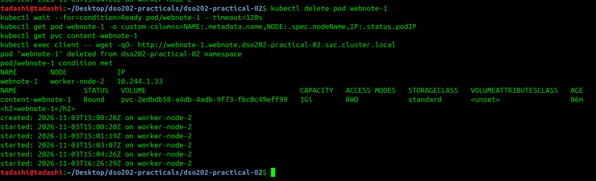


Four facts: (1) the name `webnote-1` is unchanged; (2) the same claim/volume `pvc-2edbdb58…` was reattached (claim age 82s > Pod age); (3) the original `created:` line is still there, so the file was not regenerated; (4) the IP changed from `10.244.1.7` to `10.244.1.8` — clients must use the DNS name, not the IP.

### 3.6 Stage 6 — Scaling, Retention, and Ordered Updates

Evidence: `evidence/stage6a-scaling-retention.txt`, `evidence/stage6b-partitioned-rollout.txt`, `evidence/stage6c-delete-recreate-statefulset.txt`

#### Step 1 — Scale up creates storage

```bash
kubectl scale statefulset webnote --replicas=4
kubectl wait --for=condition=Ready pod/webnote-3 --timeout=120s
kubectl get pvc -l app=webnote --no-headers | wc -l
```


#### Step 2 — Scale down terminates the highest ordinal first

```bash
kubectl scale statefulset webnote --replicas=2
kubectl get pods -l app=webnote -w
```

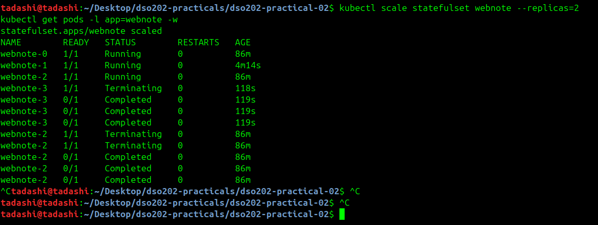

`webnote-3` terminated completely before `webnote-2` began — descending order, one at a time.

#### Step 3 — Claims are retained

```bash
kubectl get pods -l app=webnote
kubectl get pvc -l app=webnote
```

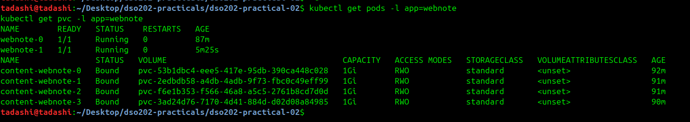

Two Pods, four claims — `persistentVolumeClaimRetentionPolicy.whenScaled: Retain`.

#### Step 4 — Scale back up; ordinal 2 gets its own data back

```bash
kubectl scale statefulset webnote --replicas=3
kubectl wait --for=condition=Ready pod/webnote-2 --timeout=120s
kubectl exec client -- wget -qO- http://webnote-2.webnote.dso202-practical-02.svc.cluster.local
```

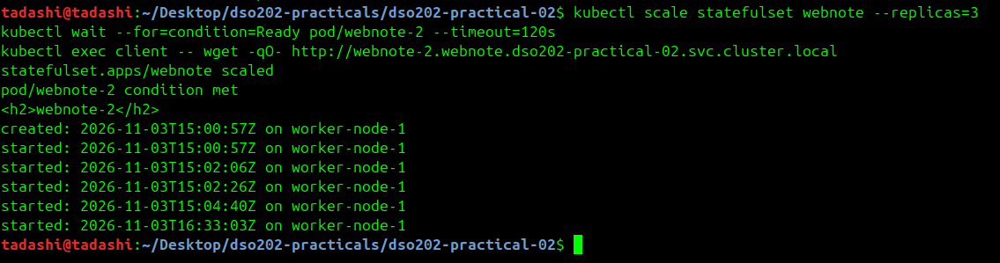

The original `created:` timestamp (15:00:57) returned — the ordinal is the identity that links a replica to its data.

#### Step 5 — Partitioned rolling update (`partition: 2`, image `nginx:1.31-alpine`)

I edited `manifests/10-statefulset-webnote.yaml` (line 49 `partition: 0` → `2`, line 122 `nginx:1.30-alpine` → `nginx:1.31-alpine`) and applied it.

```bash
grep -n 'partition:\|image: nginx' manifests/10-statefulset-webnote.yaml
kubectl apply -f manifests/10-statefulset-webnote.yaml
sleep 30
kubectl get pods -l app=webnote -o custom-columns=NAME:.metadata.name,IMAGE:.spec.containers[0].image
```
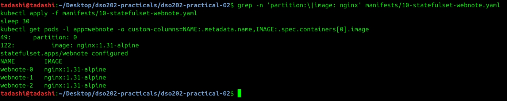

Only ordinals ≥ 2 were updated — a canary on one member.

#### Step 6 — Complete the rollout (`partition: 0`)

```bash
kubectl apply -f manifests/10-statefulset-webnote.yaml
kubectl rollout status statefulset/webnote --timeout=300s
kubectl get pods -l app=webnote -o custom-columns=NAME:.metadata.name,IMAGE:.spec.containers[0].image
kubectl exec client -- wget -qO- http://webnote-0.webnote.dso202-practical-02.svc.cluster.local
```

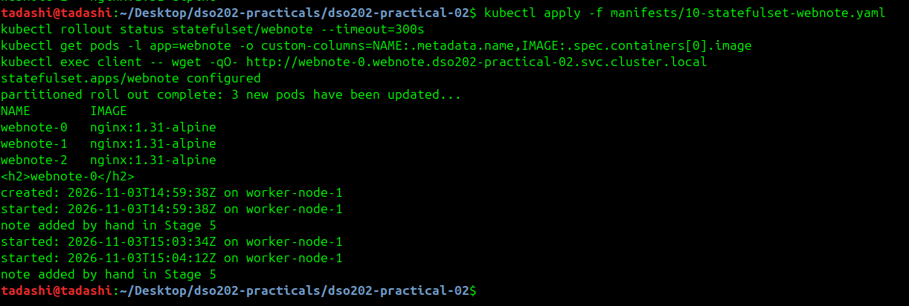

All Pods run 1.31, updated ordinal 1 then 0; `webnote-0` kept both its `created:` line and the Stage 5 note through the upgrade.

`kubectl explain statefulset.spec.updateStrategy.rollingUpdate` on this cluster lists `maxUnavailable` as *"beta-level and is enabled by default"*, and notes it may not be effective with `OrderedReady`.

#### Step 7 — Delete the StatefulSet; the claims stay

```bash
kubectl delete statefulset webnote
kubectl get pods -l app=webnote
kubectl get pvc -l app=webnote --no-headers | wc -l
```

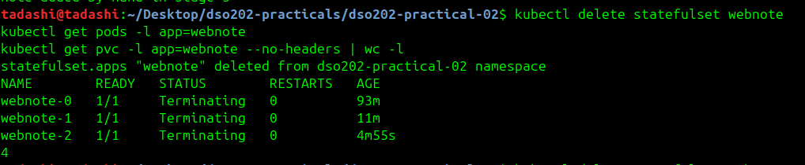

#### Step 8 — Recreate it; the data returns

```bash
kubectl apply -f manifests/10-statefulset-webnote.yaml
kubectl rollout status statefulset/webnote --timeout=300s
kubectl exec client -- wget -qO- http://webnote-1.webnote.dso202-practical-02.svc.cluster.local
```

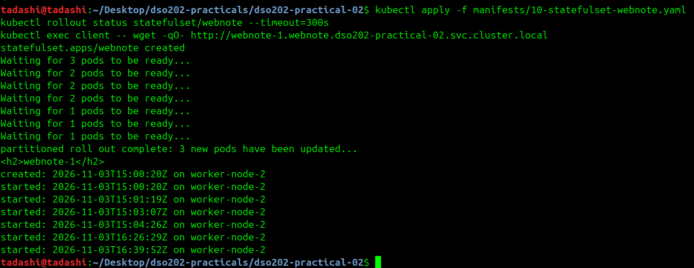

**Checkpoint met:** four claims exist, three Pods run `nginx:1.31-alpine`, and the `created:` timestamp from Stage 5 survived scale-down, update, and deletion of the controller (`whenDeleted: Retain`).

### 3.7 Stage 7 — PostgreSQL as a StatefulSet

Evidence: `evidence/stage7a-postgres-deploy.txt`, `evidence/stage7b-postgres-persistence.txt`

#### Step 1 — Secret (encoding, not encryption)

```bash
kubectl apply -f manifests/12-secret-postgres.yaml
kubectl get secret postgres-credentials
kubectl get secret postgres-credentials -o jsonpath='{.data.POSTGRES_USER}' | base64 -d; echo
```

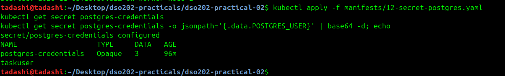

Anyone allowed to read Secrets in the namespace can decode the value with one command — access must be controlled with RBAC.

#### Step 2 — Two Services

```bash
kubectl apply -f manifests/13-service-postgres.yaml
kubectl get services
```

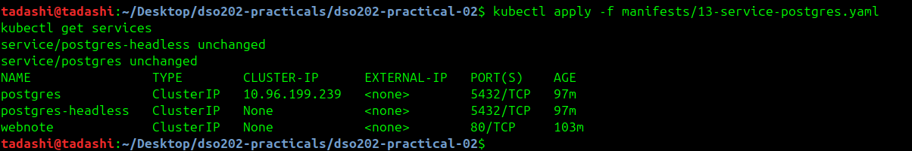

`postgres-headless` gives `postgres-0` its stable DNS name (it is the StatefulSet's `serviceName`); `postgres` is the stable ClusterIP that an application puts in its connection string.

#### Step 3 — Deploy; the readiness probe gates traffic

```bash
kubectl apply -f manifests/14-statefulset-postgres.yaml
kubectl get pods -l app=postgres -w
```
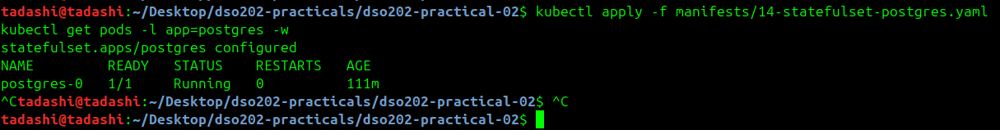

The container ran for ~17 s (`0/1 Running`) before the readiness probe passed — during that time no Service would have sent it connections.

#### Step 4 — Logs and storage

```bash
kubectl logs postgres-0 | grep -i 'init process complete'
kubectl logs postgres-0 | tail -n 4
kubectl get pvc data-postgres-0
kubectl get pv | grep -E 'NAME|postgres'
```


The database's volume has reclaim policy `Retain` because its template names `dso202-retain`.

#### Step 5 — PostgreSQL 18 data directory

```bash
kubectl exec postgres-0 -- sh -c 'echo "$PGDATA"; ls /var/lib/postgresql'
```


The volume is mounted at `/var/lib/postgresql`; the data directory `18/docker` is a subdirectory of it, so `initdb` always finds an empty directory.

#### Step 6 — Write data

```bash
kubectl exec postgres-0 -- psql -U taskuser -d tasktracker -c \
  "CREATE TABLE tasks (id serial PRIMARY KEY, title text NOT NULL, done boolean NOT NULL DEFAULT false, created_at timestamptz NOT NULL DEFAULT now());"
kubectl exec postgres-0 -- psql -U taskuser -d tasktracker -c \
  "INSERT INTO tasks (title) VALUES ('Complete Practical 2'), ('Read Unit II notes'), ('Draft the report');"
kubectl exec postgres-0 -- psql -U taskuser -d tasktracker -c "SELECT id, title, done FROM tasks ORDER BY id;"
```

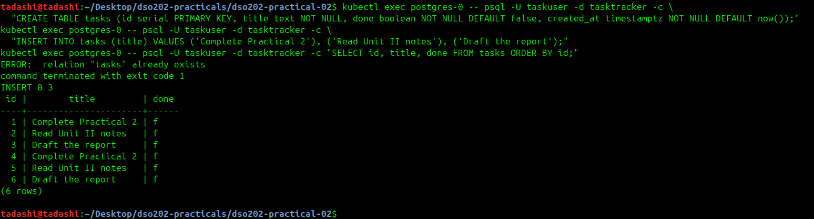

#### Step 7 — Delete the database Pod; the rows survive

```bash
kubectl delete pod postgres-0
kubectl wait --for=condition=Ready pod/postgres-0 --timeout=180s
kubectl exec postgres-0 -- psql -U taskuser -d tasktracker -c "SELECT count(*) FROM tasks;"
```

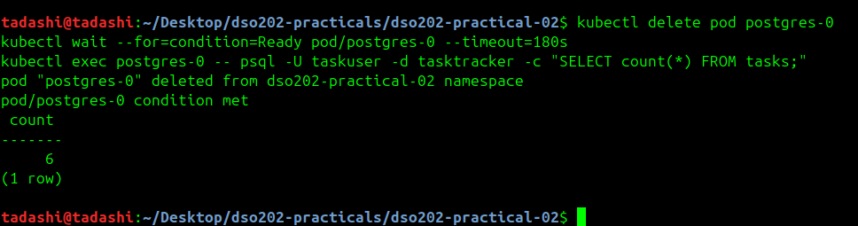

Three rows written by a process that no longer exists, read back through a new Pod.

#### Step 8 — Initialisation was skipped

```bash
kubectl logs postgres-0 | head -n 8
```

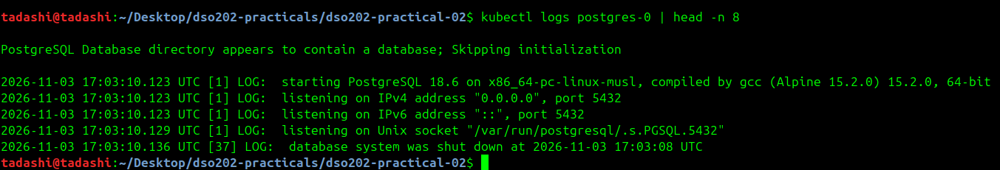

No `init process complete` this time, and "was shut down" (not "recovery in progress") shows the previous Pod shut down cleanly within its grace period.

#### Step 9 — Same claim; both Service names resolve

```bash
kubectl get pvc data-postgres-0
kubectl get pod postgres-0
kubectl exec client -- nslookup postgres.dso202-practical-02.svc.cluster.local
kubectl exec client -- nslookup postgres-0.postgres-headless.dso202-practical-02.svc.cluster.local
kubectl get pod postgres-0 -o wide
```


**Checkpoint met:** claim age (83s) spans the Pod deletion (Pod age 13s); the ClusterIP name returns the Service IP `10.96.199.239`, the headless per-Pod name returns the Pod IP `10.244.2.31`.

### 3.8 Stage 8 — Cleanup, and the Cost of Retain

#### Step 1 — Evidence captured before deleting anything

```bash
mkdir -p evidence
kubectl get all -o wide > evidence/final-state-all.txt
kubectl get pv,pvc,storageclass -o wide > evidence/final-state-storage.txt
kubectl get statefulset webnote -o yaml > evidence/final-statefulset-webnote.yaml
kubectl get events --sort-by=.lastTimestamp > evidence/final-state-events.txt
kubectl exec postgres-0 -- pg_dump -U taskuser -d tasktracker > evidence/tasktracker-dump.sql
```

Verify the dump is non-empty and contains the rows:

```bash
ls -l evidence/tasktracker-dump.sql
grep -A4 '^COPY' evidence/tasktracker-dump.sql
```


A logical dump held outside the cluster is a backup; a retained volume is not.

#### Steps 2–7 — Delete workloads, claims, PVs and the cluster


### Step 2 — delete the workloads

```bash
kubectl delete -f manifests/14-statefulset-postgres.yaml
kubectl delete -f manifests/10-statefulset-webnote.yaml
kubectl delete -f manifests/11-pod-client.yaml
kubectl delete -f manifests/05-pod-static-writer.yaml
kubectl get pods
```


### Step 3 — six claims survive
```bash
kubectl get pvc
```


### Step 4 — delete the claims; 4 standard PVs vanish, 2 Retain PVs become Released
```bash
kubectl delete pvc --all
kubectl get pv
```


### Step 5 — reclaim the static PV; the DB directory is still on the node
```bash
kubectl delete pv pv-web-static
kubectl get pv
docker exec dso202-p2-worker ls /var/local-path-provisioner
docker exec dso202-p2-worker2 ls /var/local-path-provisioner
```


### Step 6 — delete the cluster
```bash
kubectl config set-context --current --namespace=default
kind delete cluster --name dso202-p2
kind get clusters
docker ps --filter ancestor=kindest/node:v1.36.1
```

### Step 7 — the static data outlived the cluster
```bash
ls -l /home/tadashi/dso202-p2-storage/pv-web-static/
cat /home/tadashi/dso202-p2-storage/pv-web-static/ledger.txt
```

---

## 4. Analysis

**Q1. Why was the Stage 3 claim `Pending` while the Stage 2 claim bound at once?**
The field is the StorageClass's `volumeBindingMode`. The `standard` class uses `WaitForFirstConsumer` (event: *"waiting for first consumer to be created before binding"*, §3.3), so the provisioner waits until a Pod using the claim is scheduled and then creates the volume on that Pod's node. The Stage 2 claim named `manual`, which is not a StorageClass object at all (`kubectl get storageclass manual` → NotFound, §3.2 Step 4), so no binding mode applied and the controller bound it immediately to the matching `Available` PV. The design exists because node-local (or zonal) storage constrains where a Pod can run: creating the volume first could put it on a node or zone where the Pod cannot be scheduled.

**Q2. Which object decided that Stage 2 data survived and Stage 3 data did not, and who chooses it?**
The reclaim policy on the PersistentVolume, which a dynamic PV inherits from the StorageClass's `reclaimPolicy`. The static PV had `persistentVolumeReclaimPolicy: Retain` (it went `Released`, §3.2 Step 8); the dynamic PV inherited `Delete` from `standard` (`RECLAIM POLICY Delete` in §3.3 Step 3; directory gone in Step 7). In an organisation this is set by the cluster/platform administrator who creates the StorageClasses — not by the developer writing the PVC.

**Q3. Why were all Stage 4 replicas on one node, and what happens on a cloud cluster?**
All replicas mount one PVC. The first replica to be scheduled caused local-path to create the volume on `worker-node-1`, and that PV carries node affinity to that node, so the scheduler could only place the other replicas there (§3.4 Step 1). `ReadWriteOnce` allows many Pods on the same node, so nothing failed. On a managed cloud cluster with a zonal block disk, the disk can attach to only one node at a time: replicas scheduled to other nodes would stay in `ContainerCreating` with a *Multi-Attach error for volume …*, and replicas in another zone would fail with a volume node affinity conflict.

**Q4. FQDN of the second `webnote` replica, and what must exist for it to resolve.**
`webnote-1.webnote.dso202-practical-02.svc.cluster.local` (resolved to `10.244.1.7` in §3.5 Step 5). Required objects: the namespace `dso202-practical-02`; the headless Service `webnote` (`clusterIP: None`) whose selector matches the Pods; the StatefulSet `webnote` with `spec.serviceName: webnote`; the Pod `webnote-1` itself, Running and Ready (so it is listed in the Service's EndpointSlice); and the cluster DNS (CoreDNS) serving `cluster.local`.

**Q5. What happened to the claims when scaling 4 → 2 → 3, and which fields govern it?**
At 4 replicas a fourth claim `content-webnote-3` was created (count = 4). At 2 replicas, `webnote-3` then `webnote-2` were deleted but all four claims stayed `Bound` (§3.6 Step 3). At 3 replicas, the new `webnote-2` reattached the existing `content-webnote-2` and its original `created: 15:00:57` line returned; `content-webnote-3` stayed unused. The two fields are `spec.persistentVolumeClaimRetentionPolicy.whenScaled` and `.whenDeleted`, both defaulting to `Retain`.

**Q6. Why does Listing 16 mount at `/var/lib/postgresql` rather than the data directory?**
From PostgreSQL 18 the official image's `PGDATA` is `/var/lib/postgresql/18/docker` (§3.7 Step 5). Mounting the volume one level up means the image creates the `18/docker` subdirectory itself, so `initdb` always initialises an empty directory. If a volume were mounted directly at the data directory and the backend put anything in it (e.g. `lost+found` on an ext4 block device), `initdb` would refuse — *"directory … exists but is not empty"* — and the container would crash-loop. For PostgreSQL ≤ 17 the equivalent fix is `subPath` on the mount.

**Q7. Two things a StatefulSet does not provide for a database.**
(1) **Data replication / high availability** — a StatefulSet gives each replica its own empty volume; it does not copy data between them or handle failover. That is provided by the database's own replication managed by a Kubernetes **Operator** (e.g. CloudNativePG, Zalando Postgres Operator). (2) **Backups** — a retained volume lives on the same node/cluster and is lost with it (the PostgreSQL data was inside a kind node). Backups come from logical/physical backup tools (`pg_dump`, operator-scheduled backups to object storage) or **VolumeSnapshots** via a CSI driver.

**Q8. Why did the PVs become `Released`, not `Available`, and how is storage returned to service?**
With `Retain`, deleting the claim leaves the PV still referencing the old claim in `spec.claimRef` (§3.2 Step 8 shows the deleted claim in the `CLAIM` column). Kubernetes deliberately will not bind it to a new claim, because the volume may contain another workload's data. An administrator must decide: back up or wipe the data, then either delete and recreate the PV (as in Stage 2 Step 10) or clear `spec.claimRef` (`kubectl patch pv <name> -p '{"spec":{"claimRef":null}}'`) so it becomes `Available` again — or delete the PV and the underlying storage to free it.

---

## 5. Reflection

> **Edit this section in your own words** — it is worth 2 of the 5 report marks. The points below are prompts drawn from what actually happened in this run.

**What was difficult.** The guide's host directory `/tmp/dso202-p2-storage` did not work on my machine because Docker runs as **Docker Desktop** (a LinuxKit VM), so a host path under `/tmp` is not what the kind node container sees. The fix was to point `extraMounts.hostPath` at `/home/tadashi/dso202-p2-storage`. *(Describe here what you actually saw — e.g. an empty `/mnt/dso202-static` or a mount error — and whether you had to recreate the cluster, since kind only applies `extraMounts` at creation time.)* Useful diagnostic commands: `docker exec dso202-p2-worker ls -ld /mnt/dso202-static` and `docker info --format '{{.OperatingSystem}}'`.

**An error I met and how I diagnosed it.** The PVC resize in Stage 3 returned `Error from server (Forbidden)`. Reading the full message (*"the storageclass that provisions the pvc must support resize"*) and checking `kubectl get storageclass` (`ALLOWVOLUMEEXPANSION false`) showed the API server rejected it before the provisioner was involved. Also, `df -h /data` reported `62.7G` for a 1Gi claim — at first this looked like a bug, but it is the Docker Desktop VM's disk, which shows local-path does not enforce capacity.

**What I would do differently.** Check `docker info` before writing the cluster config, and always capture output with `| tee evidence/...` while working, instead of relying on screenshots that can't be searched or diffed.

**One thing still unclear.** How a production operator safely fails PostgreSQL over to a replica on a different node when each replica's volume is node-local — and how `maxUnavailable` (beta) interacts with `OrderedReady` for StatefulSets.

---

## 6. References

All accessed 2026-11-03.

1. DSO202 Practical 2 guide — https://hackmd.io/@sarojsanyasi/dso202-practical-02
2. DSO202 Practical 2 companion manifest file — https://hackmd.io/@sarojsanyasi/B1ZPV7oPMx
3. Kubernetes — Persistent Volumes: https://kubernetes.io/docs/concepts/storage/persistent-volumes/
4. Kubernetes — Storage Classes: https://kubernetes.io/docs/concepts/storage/storage-classes/
5. Kubernetes — StatefulSets: https://kubernetes.io/docs/concepts/workloads/controllers/statefulset/
6. Kubernetes — DNS for Services and Pods: https://kubernetes.io/docs/concepts/services-networking/dns-pod-service/
7. Kubernetes — Secrets: https://kubernetes.io/docs/concepts/configuration/secret/
8. kind — Configuration (extraMounts): https://kind.sigs.k8s.io/docs/user/configuration/
9. Rancher local-path-provisioner: https://github.com/rancher/local-path-provisioner
10. PostgreSQL Docker official image (PGDATA in 18+): https://hub.docker.com/_/postgres
